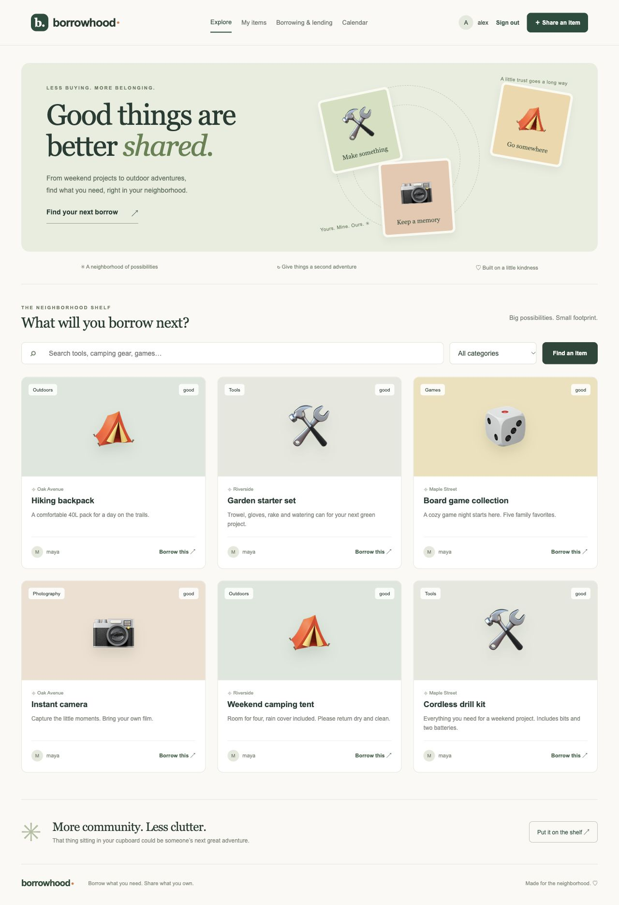

# Borrowhood 

**Borrow what you need. Share what you own.**

A full-stack community tool library built with **Angular 20**, **Django REST Framework**, and **PostgreSQL**. Neighbors share tools, camping gear, cameras and games, request dates, and track each item from approval to happy return.



## What you can do

- Register, sign in, and manage your own listings.
- Upload item photos, search by keyword/neighborhood, and filter categories.
- Request an inclusive date range with a note to the owner.
- Approve or decline requests; confirm pickup and return with condition notes.
- Cancel pending/approved requests and pause/resume listings.
- View active loans, requests, overdue returns and completed loans on your dashboard.
- See your approved reservations on a monthly calendar.
- Leave one 1–5 star review after returning a borrowed item.
- Prevent overlapping approvals with PostgreSQL transactions and item row locks.

## Run with Docker and PostgreSQL

Requires Docker Desktop (running) and Docker Compose.

```sh
git clone https://github.com/ShreyaMP1999/borrowhood.git
cd borrowhood
cp .env.example .env
docker compose up --build -d
docker compose exec backend python manage.py seed_demo
```

Open **http://localhost:8080**. The first build may take a few minutes; if seeding starts before the backend is ready, wait for `docker compose logs backend` to show Gunicorn running, then retry the seed command. Data and uploaded photos persist in named volumes.

For administrator access:

```sh
docker compose exec backend python manage.py createsuperuser
```

Then visit **http://localhost:8080/admin/**. Add categories here for a fresh database without demo data. Use `docker compose down` to stop the app while preserving volumes.

## Local development

Requires Python 3.13 and Node.js 24. The default database is SQLite for an easy single-user preview. Use PostgreSQL for concurrent bookings and the full test suite.

Backend, from the repository root:

```sh
python3 -m venv .venv
source .venv/bin/activate
pip install -r backend/requirements.txt
cd backend
python manage.py migrate
python manage.py seed_demo
python manage.py runserver
```

Frontend, in a second terminal from the repository root:

```sh
cd frontend
npm ci
npm start
```

Open **http://localhost:4200**. The Angular development proxy forwards `/api` and `/media` to Django on port 8000. No external API keys are required.

### Demo accounts

| Role | Username | Password |
| --- | --- | --- |
| Owner of demo items | maya | BorrowhoodDemo!2026 |
| Borrower | alex | BorrowhoodDemo!2026 |

Sign in as **alex**, request an item for today, then sign out and sign in as **maya**. Open **Borrowing & lending** to approve, confirm pickup, and confirm return. Sign back in as alex to leave a review. Demo credentials and fictional listings are only for local development; seeding is disabled with DEBUG=0.

### Use your own PostgreSQL

Create a database and set the following environment variables in the terminal that runs Django (a `.env` file is loaded by Docker Compose, not automatically by plain Python):

```sh
export POSTGRES_HOST=127.0.0.1
export POSTGRES_PORT=5432
export POSTGRES_DB=borrowhood
export POSTGRES_USER=borrowhood
export POSTGRES_PASSWORD='your-local-database-password'
python manage.py migrate
python manage.py runserver
```

## Verify the project

```sh
# From backend/ with the virtual environment active
python manage.py check
python manage.py makemigrations --check --dry-run
python manage.py test --verbosity 2

# From frontend/
npm run build
```

The 24 backend tests cover account validation, token revocation, privacy, owner permissions, invalid dates/statuses, overlapping bookings, cancellations, reviews, overdue counts, and simultaneous approvals. The concurrency test requires PostgreSQL and is skipped on SQLite. The test database user must have permission to create test databases. GitHub Actions runs the backend suite against PostgreSQL 16 and compiles the Angular production bundle on each push and pull request.

Local validation completed: 24/24 tests passed on PostgreSQL 14; SQLite passed with the concurrency test skipped; Angular production build passed. Docker Compose configuration was validated, but the container stack was not executed in the authoring environment because its Docker daemon was stopped.

## Explore the code

```text
backend/
  config/             Settings and URL configuration
  library/
    models.py         SQL relationships and constraints
    accounts.py       Registration and authentication
    serializers.py    API validation and representations
    services.py       Transactional booking state changes
    views.py          Listings, bookings, reviews and dashboard
    tests.py          API and concurrency regression tests
frontend/
  src/app/            Angular views, forms, typed client and styles
docs/                 API guide, architecture, SQL examples and build segments
.github/workflows/    Automated verification
compose.yml           PostgreSQL + Django + Angular/Nginx local stack
```

Read the [API guide](docs/API.md), [architecture and relationships](docs/ARCHITECTURE.md), [SQL reporting examples](docs/queries.sql), and [10 build segments](docs/SEGMENTS.md).

This is a portfolio MVP. Notifications, payments, messaging, password reset and public hosting are future work; see the architecture guide for deployment requirements and current boundaries.
