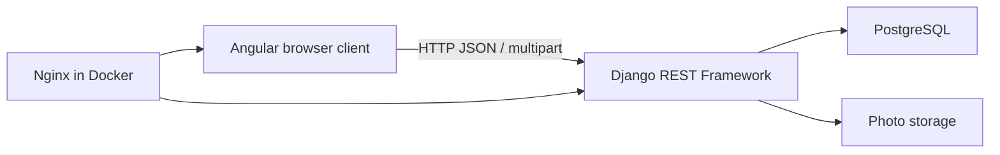
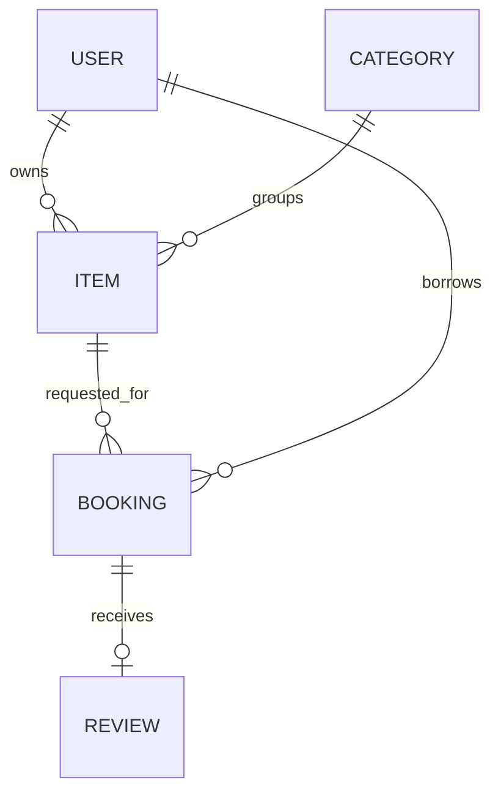

# How Borrowhood works

Django migrations are the authoritative schema. Foreign keys preserve relationships; protected item/borrower references preserve lending history. Database checks reject reversed date ranges and ratings outside 1–5. A composite index supports item/status/date conflict queries.

## Concurrent approvals

Within `transaction.atomic`, the transition service locks the Item row with `select_for_update`, then the Booking row. Every approval for that item must acquire the same item lock before checking inclusive date overlap. The first approval reserves the item; the second waits, sees the committed reservation, and fails with HTTP 400. Different items can be approved independently. All other transitions follow the same lock order.

The PostgreSQL transaction test uses two separate connections and simultaneous worker threads to confirm exactly one overlapping approval succeeds. SQLite is a convenient single-user local preview and does not supply these row-lock guarantees. Use PostgreSQL for concurrent use.

Use the API transition service for status changes. Booking records are read-only in Django admin so it cannot bypass the booking rules. Direct SQL writes are outside the service's concurrency guarantee.

## Boundaries and future work

This is a portfolio MVP with one physical unit per listing. Availability is date-based; requests await owner approval. Categories are managed by an administrator. Reviews are borrower-to-item reviews tied to one completed booking. The calendar shows only the signed-in user's reservations. Overdue means collected with an end date before today's UTC date. Email reminders, chat, payments, identity checks, password reset, and per-owner availability windows are future extensions.

The Angular UI uses a single root component with typed HTTP models and tabs for the four primary views. Larger versions should extract feature components and routed pages. Stored usernames and comments render through Angular interpolation. Image uploads are validated by Pillow and size-limited. The local Docker setup binds only to loopback and uses Nginx to serve photos/static assets and proxy API requests without cross-origin configuration.

Before a public deployment, use HTTPS, unique secrets, DEBUG=0, explicit allowed hosts, a shared throttling cache, persistent backups and managed media storage. Run `manage.py check --deploy` and configure secure cookies/HSTS for your hosting topology. Demo accounts are for local use and seed_demo refuses to run when DEBUG is disabled.
